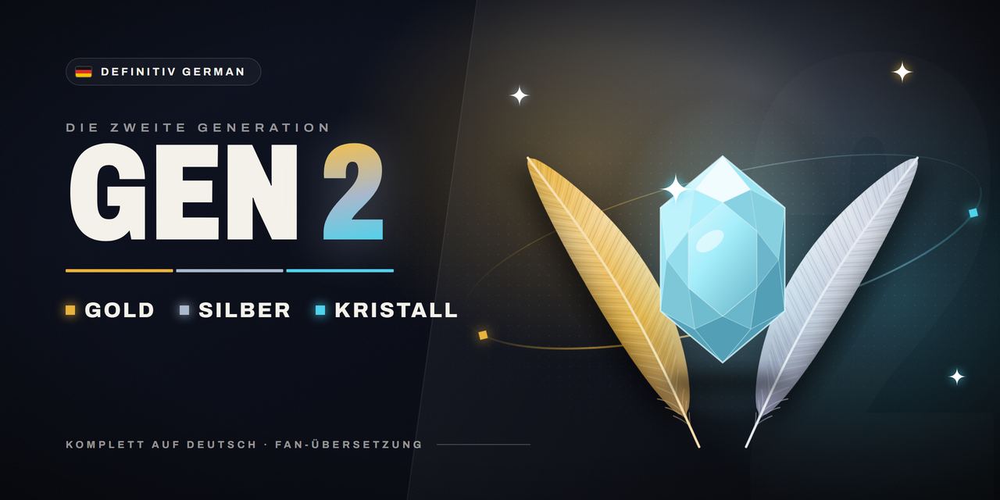

# Definitiv German Gen 2

Komplett deutsche Goldene, Silberne und Kristall-Edition für [gen1recomp](https://github.com/bryanthaboi/gen1recomp) – so, als wäre
die englische ROM die deutsche.

*A full German translation mod for gen1recomp (Gold, Silver, Crystal). It reads everything from your own German ROMs.*

## Was der Mod macht

- **Texte und Namen** – Dialoge, Kämpfe, Menüs, Pokédex, Pokémon, Attacken, Items, Trainer, Orte – im Wortlaut
  der deutschen Originale
- **Schrift und Tastaturen** – Umlaute, ß und die Sonderzeichen der deutschen Spiele; Namen, Boxen und Briefe
  mit Ä, Ö, Ü, ä, ö, ü und ß, angeordnet wie im Original
- **Grafiken** – Titelbild, Beutel, PokéCom, Trainerpass, Pokédex, Diplom, Intro, Icognito-Szenen, Schilder,
  Kristall: Geheimgabe
- **Anordnung** – Menüs, Kästen und Spalten sitzen wie in der deutschen ROM
- **Zusätze von gen1recomp** – Optionen, Mod-Verwaltung und Link-Meldungen auf Deutsch

Der Mod enthält **keine Texte oder Grafiken der Spiele**, nur Code und „Rezepte“ (Positionen in der ROM). Beim
ersten Start liest er deine deutsche ROM und legt das Ergebnis im Mod-Cache ab; danach startet er aus dem Cache.

## Voraussetzungen

- gen1recomp **0.3.97** oder neuer, mit importierter englischer ROM:
  Gold oder Silber (USA, Europe) bzw. Kristall (USA, Europe) Rev 1 oder (USA) 1.0
- die **deutsche ROM** der Edition, die du spielen willst (jede Edition braucht nur ihre eigene):

| Edition | Datei | MD5 |
|---|---|---|
| Goldene Edition | Pokemon - Goldene Edition (Germany) (SGB Enhanced) (GB Compatible).gbc | `7542ec9b695d4fe38adfdaaa57364d83` |
| Silberne Edition | Pokemon - Silberne Edition (Germany) (SGB Enhanced) (GB Compatible).gbc | `f1f013cd591bc4ea77305bbc9f8cbb3c` |
| Kristall-Edition | Pokemon - Kristall-Edition (Germany).gbc | `a35c0fa2e3b3d1c1779cd9f2352bc427` |

## Installation

1. Im Launcher unter **MODS** den Mod suchen und installieren – oder die `.zip` aus dem
   [neuesten Release](https://github.com/FadeyMods/Definitiv-German-Gen-2/releases/latest) über
   **Import mod .zip** einspielen.
2. In den **Details** des Mods die deutsche ROM auswählen. Der Launcher prüft sie und legt sie beim Mod ab.
3. Mod aktivieren und spielen.

Ist noch der ältere Mod `deutsch-gen2` installiert, bitte entfernen – der Launcher meldet sonst einen Konflikt.

Die Mod-Verwaltung erreichst du im Spiel über **OPTION → MODS** (nach EXTRAS) oder im Launcher unter **MODS**.
Das START-Menü hat wie im Original keine Zeile MODS.

## Online

Die Online-Funktionen von gen1recomp (KONNEX-Klub online, Arenen, Turniere) sind mit aktivem Mod **nicht
nutzbar**: gen1recomp lässt online nur Mods zu, die nichts am Programm ändern, und dieser Mod muss eingreifen,
um alles aus deiner deutschen ROM zu lesen. Zum Online-Spielen den Mod unter **MODS** abschalten – das Spiel ist
dann englisch.

## Bekannte Abweichungen von der deutschen ROM

Sie kommen von gen1recomp selbst und lassen sich im Mod nicht sauber beheben:

- Der Launcher bleibt englisch.
- Der Abspann ist der von gen1recomp (dessen Mitwirkende statt des Original-Teams); der Mod übersetzt die
  Überschriften.
- Was gen1recomp zusätzlich hat (Optionen wie EXTRAS und STEUERUNG, Mod-Verwaltung, Online-Bereich), gibt es
  im Original nicht; der Mod übersetzt es im Stil der deutschen Spiele.
- Ruhmeshalle: die Spielerseite (Name, ID, Spielzeit) steht nur einen Augenblick, Prof. Eichs Bewertung fehlt.
- Texte nach dem Benutzen eines Items im Team-Menü (z. B. Vitamine) zeigt gen1recomp ohne Seitenwechsel auf
  zwei Zeilen.
- Im Kampf fehlt bei Pokémon mit weniger als vier Attacken der Strich für die leeren Plätze.

Was sich in einer Version geändert hat, steht im jeweiligen
[Release](https://github.com/FadeyMods/Definitiv-German-Gen-2/releases).

Weitere Generationen: [Definitiv German Gen 1](https://github.com/FadeyMods/Definitiv-German-Gen-1) · [Definitiv German Gen 3](https://github.com/FadeyMods/Definitiv-German-Gen-3)
